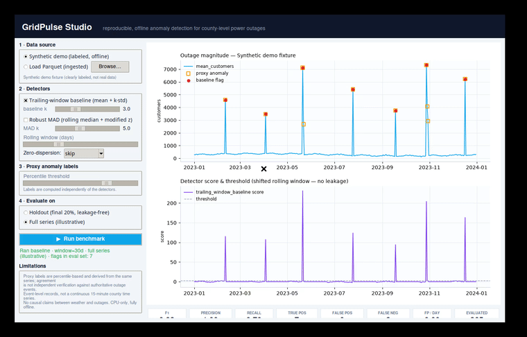
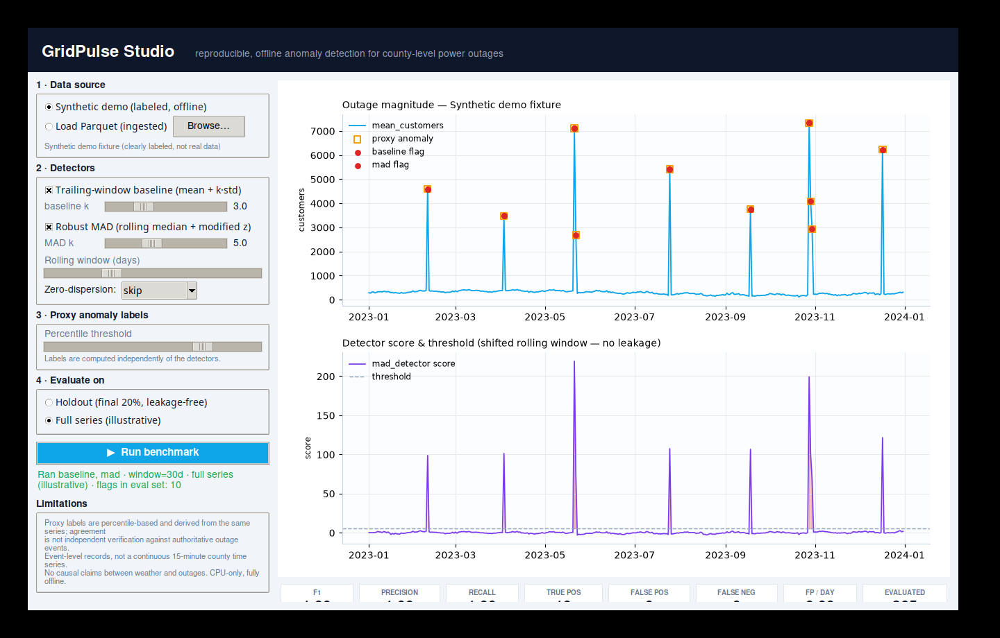

# GridPulse

**Reproducible, CPU-friendly research benchmark for detecting anomalous county-level power-outage events — with a desktop GUI.**

GridPulse turns the OpenEI / PNNL *Event-correlated Outage Dataset in America* (CC BY 4.0) into a transparent, pre-registered, fully offline benchmark: you load data, tune detectors, and inspect exactly *what* was flagged and *why* — interactively or on the command line, with the same code behind both.

---

## Demo



> Watch the full run in [`docs/assets/gui_demo.mp4`](docs/assets/gui_demo.mp4) (interactive desktop app: switch detectors, tune thresholds, re-run live).

## The GUI in action



*GridPulse Studio* is a dependency-light Tkinter desktop app built on the same detector and evaluation code as the CLI. It plots the outage magnitude time series, marks proxy-anomaly candidates (orange), overlays detector flags (red), draws the robust-detector score against its threshold, and updates a precision / recall / F1 / false-positive card row after every run.

```bash
gridpulse gui                    # launch interactively
gridpulse gui --demo             # scripted parameter tour (used for screenshots/video)
gridpulse gui --data data/processed/analysis.parquet   # open an ingested file
```

In the sidebar you can switch between the labeled synthetic fixture and an ingested Parquet file, toggle the two detectors, drag their windows and thresholds, set the proxy-label percentile, and choose to evaluate on the leakage-free holdout or the full series.

**Typical workflow**

1. Launch `gridpulse gui`. On startup it loads a clearly-labeled synthetic fixture (no data or network needed).
2. Press **▶ Run benchmark** — the top panel shows the outage magnitude series with detected flags in red (orange squares are the proxy-label threshold), the bottom panel shows the detector score versus its threshold.
3. Drag the detector / percentile sliders and hit **Run benchmark** again to see detection change in real time — the metric cards (F1, recall, false positives per day) update with every run.
4. To use real data: `gridpulse ingest <merged.csv>` then pick *Load Parquet (ingested) → Browse…*.
5. For an archived, versioned result run the same detectors via the CLI with `gridpulse run --data data/processed/analysis.parquet`.

---

## Why GridPulse instead of existing tools and websites?

Public outage portals and general-purpose ML libraries all answer slightly different questions than GridPulse. The short version: **GridPulse is a *research protocol*, not a dashboard or a library.** Every result it produces is reproducible, offline, and honest about its own limitations.

| Existing option | What it does well | What you can't do with it |
|---|---|---|
| **poweroutage.us** / live outage maps | Great real-time operational view of *current* outages | Closed data, no reproducibility, no offline use, no anomaly detectors or metrics, no formal anomaly definition — "anomalous" means whatever the site says it means |
| **EIA / DOE-417 / EAGLE-I dashboards** | Authoritative raw outage statistics | Raw counts only — no detection algorithm, no evaluation split, no false-alarm accounting |
| **Generic anomaly libraries** (PyOD, `statsmodels`, scikit-learn) | Many algorithms, well tested | No outage data, no proxy-label protocol, no chronological split discipline, no provenance — your comparison is only as honest as your notebook discipline |
| **Ad-hoc Jupyter notebooks** | Fast to prototype | Unrepeatable results, drift from config to config, no versioned artifacts, no source manifest; "it works on my machine" is an *unreproducible* claim |
| **Freemium SaaS anomaly products** | Polished UI, no setup | Paywalled, account required, closed methods, and your (sensitive) outage data must be uploaded to a third party |

GridPulse's advantages are concrete, not aesthetic:

1. **Reproducible and pre-registered.** Fixed random seeds, a versioned benchmark config, saved metrics and predictions, and a pre-registered protocol (`docs/preregistration.md`) that is intentionally immutable. A reviewer can re-derive every number.
2. **Leakage-free by construction.** Chronological train/val/test splits, detectors that only ever look at *shifted* trailing windows, and proxy labels defined independently of any model. No accidental future-peeking.
3. **Honest about what it does and doesn't prove.** Proxy labels are percentile-based, explicitly not independent verification; limitations are documented, not buried.
4. **Fully offline and CPU-only.** No APIs, no cloud, no GPU, no accounts. It runs on a laptop in seconds and your county-outage data never leaves your machine.
5. **Built-in provenance.** Every ingested source is recorded with publisher, license, SHA-256, and attribution in `data/provenance/manifest.json` (CC BY 4.0 verified).
6. **Open source (MIT) with configuration parity.** The GUI, the CLI, and the generated HTML report all exercise the *same* detector and evaluation code — what you see on screen is exactly what gets archived to `experiments/`.
7. **Extensible.** Detectors are small, documented functions (`detectors.py`); adding a method is a few lines, and it is immediately available in the GUI, CLI, and reports.

Existing tools answer *"what is out now?"* or *"how do I run an anomaly detector?"*; GridPulse answers *"can a lightweight statistical detector spot unusually large outages, how well, and how would I know?"* — with the grey areas written down.

---

## Quickstart

```bash
# Create virtual environment (Python 3.10+)
python3.11 -m venv .venv
source .venv/bin/activate
pip install -e ".[dev]"

# GUI (optional, needs Tkinter + Pillow)
pip install -e ".[gui]"
gridpulse gui                    # or: gridpulse gui --demo

# Offline CLI smoke test with the synthetic fixture (no network, no real data required)
gridpulse run --synthetic --out-dir experiments/m1_synthetic

# Check sources
gridpulse check-sources
```

## Data Provenance

Primary dataset: Event-correlated Outage Dataset in America (OpenEI / PNNL), CC BY 4.0.  
See `docs/data_provenance.md` and `data/provenance/manifest.json`.

Large raw files are gitignored. Download manually if desired:

```bash
# Example (user responsibility)
mkdir -p data/raw
curl -L -o data/raw/Outage_Dataset_R1.zip https://data.openei.org/files/6458/Outage_Dataset_R1.zip
unzip -l data/raw/Outage_Dataset_R1.zip   # inspect
# Then extract a merged CSV and ingest:
gridpulse ingest data/raw/Outage_Dataset/eaglei_outages_2014_merged.csv
```

## Reproducibility

```bash
# From local data (or synthetic)
gridpulse run --config configs/benchmark.yaml --synthetic
# or
gridpulse run --data data/processed/analysis.parquet --out-dir experiments/m1
```

Fixed random seeds, versioned config, and saved metrics/predictions ensure bit-for-bit reproducibility on the same inputs.

## Research Question

Can lightweight statistical anomaly detectors identify unusually large or rapidly increasing county-level power outages, and how do their detection performance and false-alarm rates compare against simple baselines?

See `docs/preregistration.md` for the full protocol. This is retrospective detection, not operational forecasting.

## Limitations

- Proxy labels derived from the magnitude series itself; not independently verified events.
- Event-level aggregates rather than continuous high-resolution time series.
- No causal claims.
- Synthetic fixtures are clearly labeled and never real data.
- See `docs/limitations.md`.

## License

MIT for original code. Datasets retain their own licenses (CC BY 4.0).